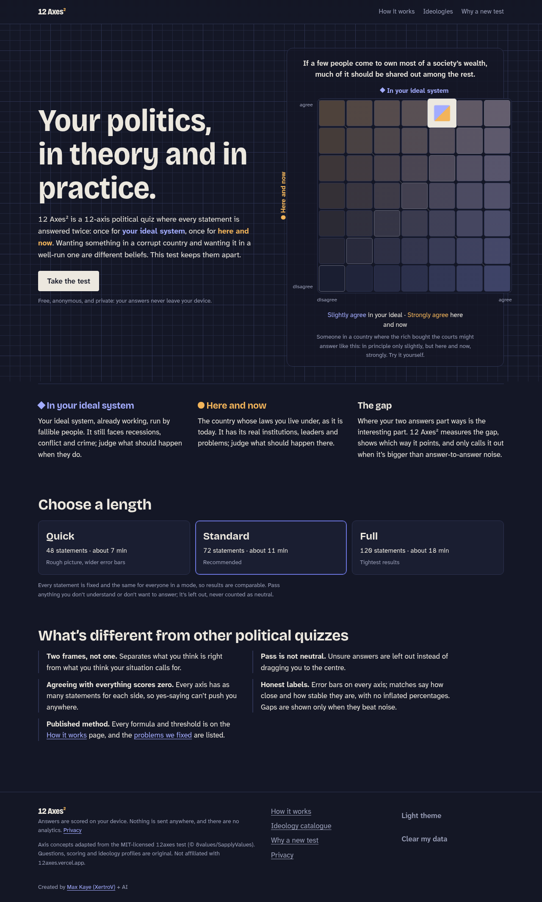
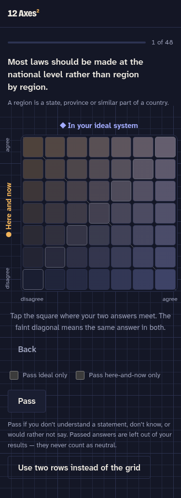
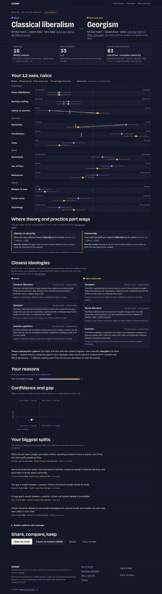
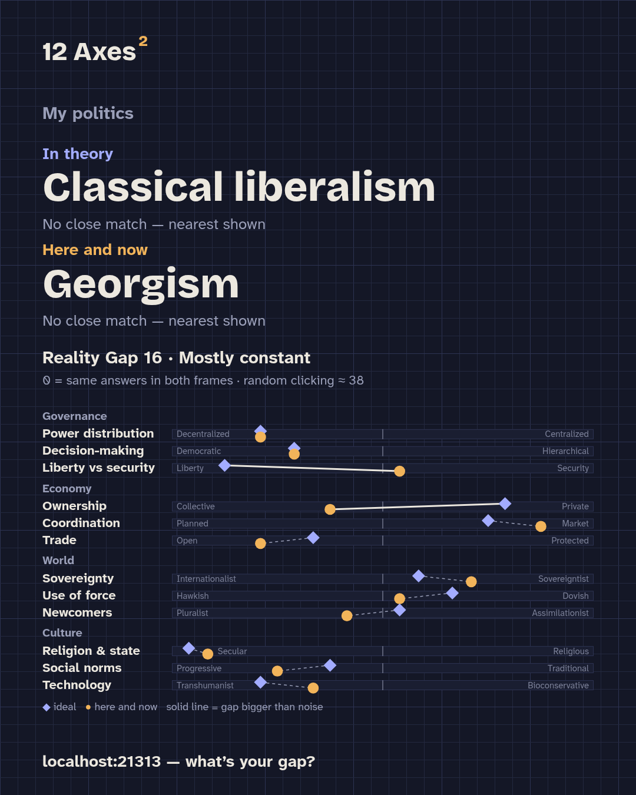

# 12 Axes²

**A 12-axis political values quiz where every statement is answered twice: once for your ideal system, once for here and now in your own country.**

**Take it: https://12axes-squared.netlify.app**

One click on a 7×7 grid gives both answers. Your results show where your ideals and your practical politics agree, where they part ways, and which ideologies you fit in theory and in practice.



## Why two frames

Most political quizzes ask one question when there are really two:

- **What would a well-designed system do?**
- **What should my country do now, given where it is?**

Seizing elite wealth may be justified in a captured state that has no lawful route to reform. It is much harder to justify in a country whose problems can be solved within its own legal framework. Someone can hold both of those views without contradiction. A single-frame quiz averages them into mush. 12 Axes² keeps them apart, so it separates what you think is *just* from what you think is *necessary*.

| The grid | Results |
|---|---|
|  |  |

Share cards are drawn on your device in three sizes (post, story, wide):



## What's different from 12axes

The full critique is in [`docs/criticisms.md`](docs/criticisms.md).

- **Two frames per statement.** Each answer gives an ideal-system score and a here-and-now score, and the gap between them on every axis.
- **"Pass" is a skip, not neutral.** You can pass one frame or both. Passed items are left out of your scores.
- **Balanced, honest scoring.**
  - Every axis has equal numbers of items keyed each way, which cancels yes-saying bias.
  - Scores come with standard errors.
  - Gaps are only flagged when they beat a threshold calibrated by simulation.
  - Random clicking is detected.
- **Defensible matching.**
  - Ideology positions come from three AI coders from different model families (Claude Opus, GPT-6.1-sol, Grok). Each one answered the same 120 statements in both frames, blind to item ids, and the positions are the coders' median scored with the same engine that scores you.
  - Match labels and the split headline are calibrated against simulated adherents, not hand-tuned percentages.
- **Private by construction.**
  - It's a static site: no backend, no analytics, no cookies, no third-party requests. A strict CSP sets `connect-src 'none'`.
  - Share links carry only your scores, never your answers, in the URL fragment, so the host never receives them.
- **Original content.** All 120 statements, the scoring and the ideology profiles are new. A provenance gate (`just overlap`) checks every item against both upstream banks using hashed shingles.

## Using it

```sh
just install      # pnpm install (with a Node network workaround; see justfile)
just dev          # http://localhost:21313
just test         # unit + invariant tests (vitest)
just e2e          # Playwright: quick run, no-network check, share parity, keyboard grid
SITE_ORIGIN=https://example.org BASE_PATH=/ just build   # static site in dist/
just deploy       # build for 12axes-squared.netlify.app and publish it (needs `netlify login`)
```

A production build needs `SITE_ORIGIN` and `BASE_PATH`. `scripts/og.ts` uses them to emit link-preview pages (`/p/<ideal>/<now>/`) and preview images. Serve `dist/` from any static host.

Data pipelines:

| Command | What it does |
|---|---|
| `just archetypes` | Builds ideology vectors from the coders' answer sheets in `content/archetypes/raw/` and runs leave-one-coder-out validation. |
| `just calibrate` | Simulates respondents, then writes gap thresholds, match-label cut-offs, the careless-answer threshold and an accuracy report to `src/data/calibration.json`. |
| `just overlap` | Provenance gate: fails if any item overlaps an upstream question bank. |

## Layout

```
content/items/        120 statements (12 axes × 10), keyed, faceted, tiered Quick/Standard/Full
content/archetypes/   ideology catalogue, blinded coder sheets, built vectors
src/engine/           scoring, gaps, matching, gap typology, share-link codec (pure TS, tested)
src/ui/               React UI; src/share/card.ts draws share cards with Canvas 2D
scripts/              calibration, archetype build, provenance gate, OG previews, screenshots
docs/                 research corpus, design spec, criticisms, virality playbook
```

## Limitations

It is not a validated instrument yet:

- The items haven't been tested on real respondents. There is no factor analysis and no test–retest data.
- Thresholds come from a simulation model.
- The ideology positions are AI-coded.

The method page in the app and [`docs/criticisms.md`](docs/criticisms.md) list these limitations in full.

## Credits

- Axis concepts are adapted from the MIT-licensed [12axes](https://github.com/politicaltests/politicaltests.github.io) (© 8values / SapplyValues contributors). Questions, scoring and ideology profiles are original.
- Not affiliated with 12axes.vercel.app.
- Country context uses the World Bank's [Worldwide Governance Indicators](https://www.worldbank.org/en/publication/worldwide-governance-indicators) (CC BY 4.0).
- Fonts: Bricolage Grotesque and Atkinson Hyperlegible Next (SIL OFL), self-hosted.

## Licence

Code is MIT ([`LICENSE`](LICENSE)). Statements, the ideology catalogue and docs are CC BY 4.0 ([`LICENSE-CONTENT.md`](LICENSE-CONTENT.md)).

Think a statement is loaded or unclear? [Open an issue](https://github.com/clankercode/12xx2/issues/new?labels=statement) — the quiz has a link on every statement that fills in its ID.

Created by [Max Kaye (XertroV)](https://xk.io) + AI.
